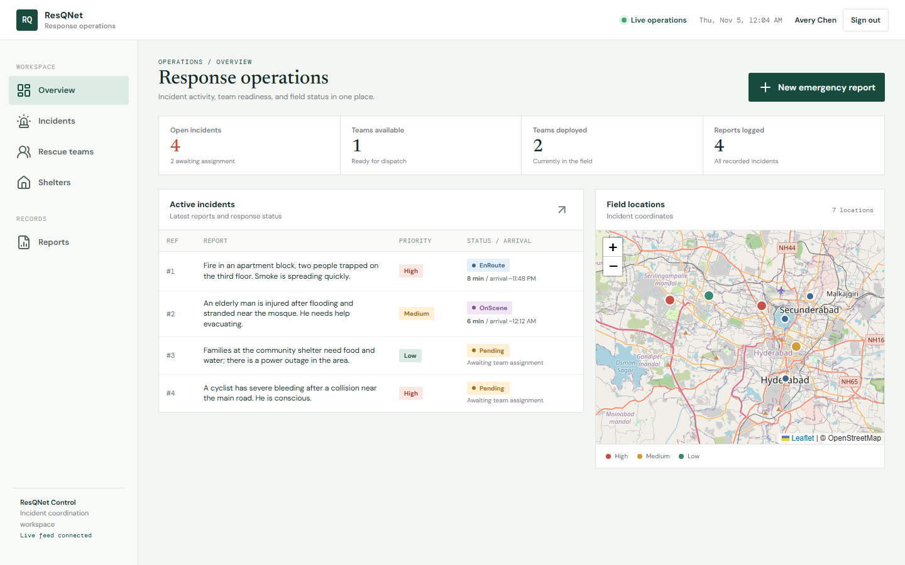
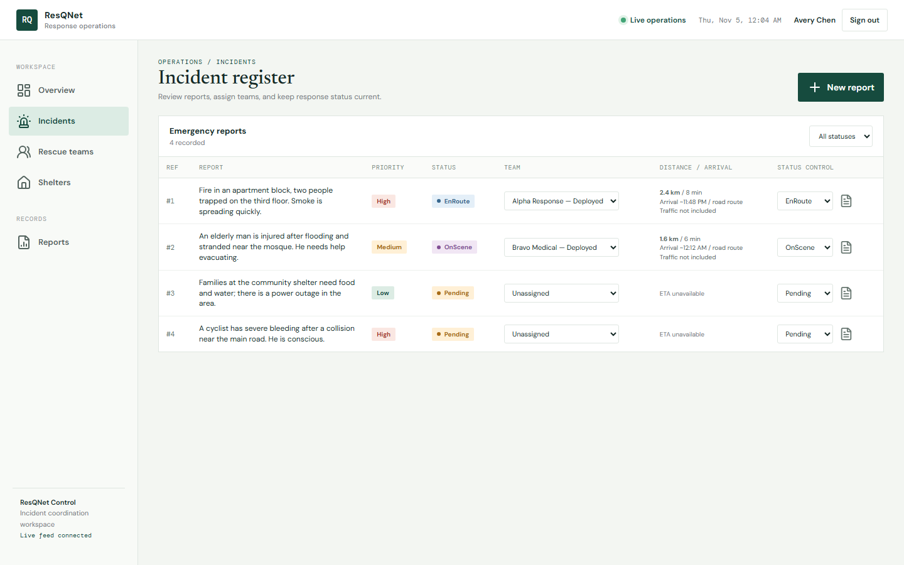
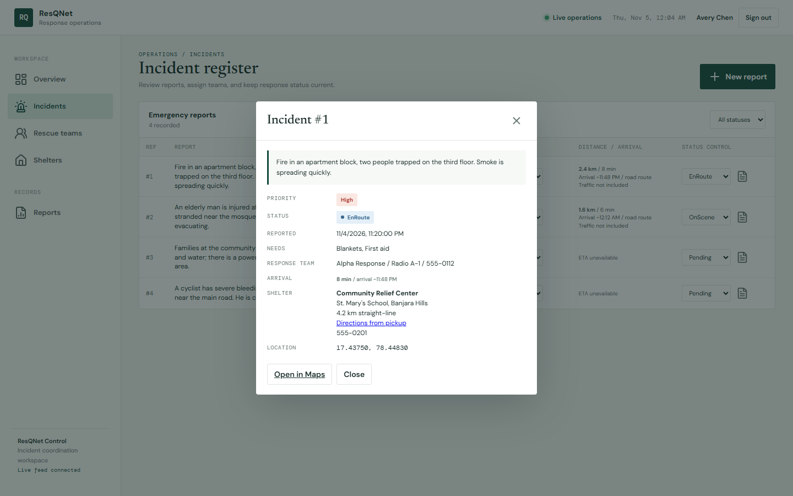
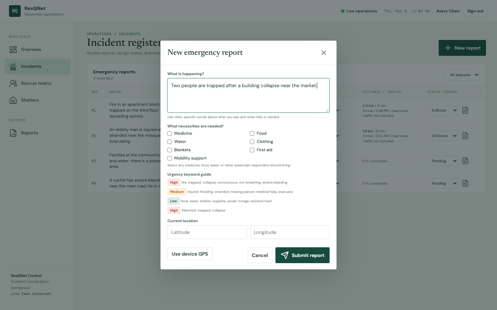
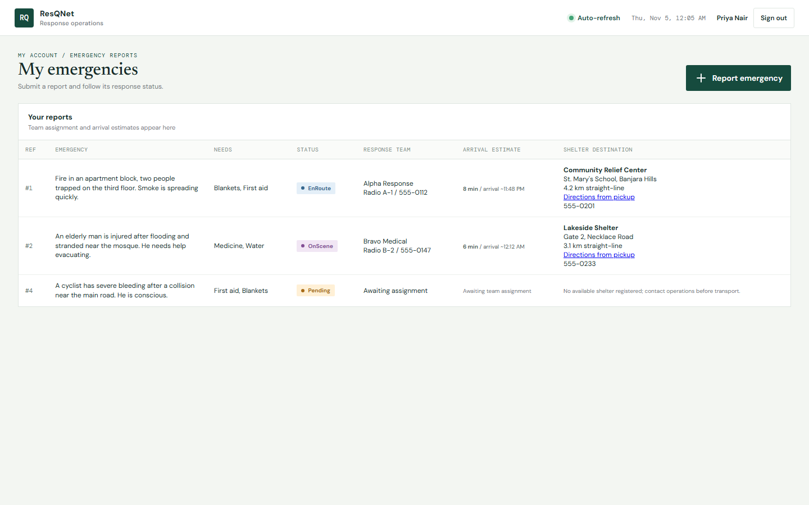
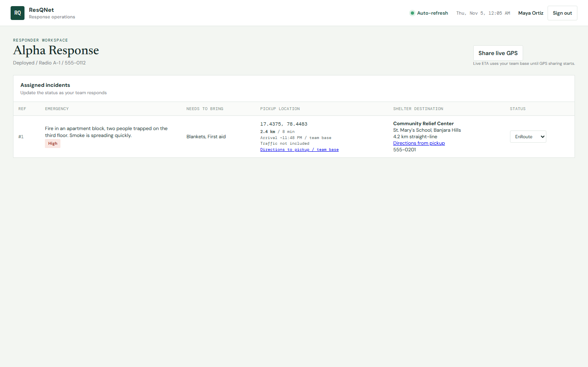
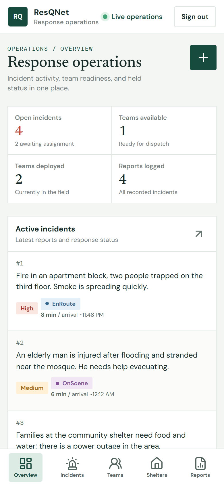
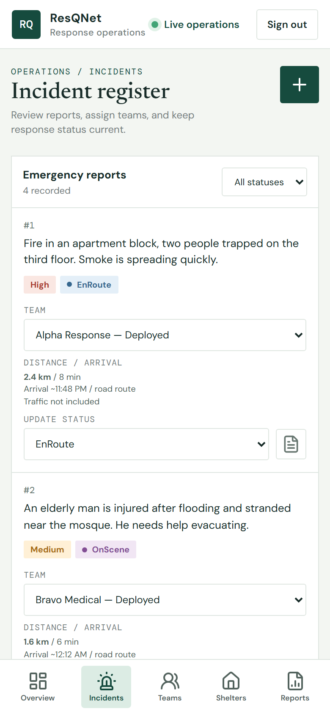
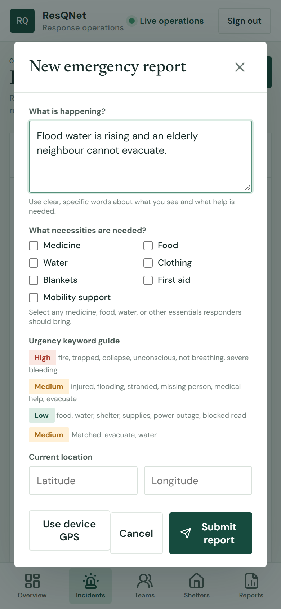

# ResQNet

Emergency response coordination: citizens report an incident, the system scores its
priority, assigns the nearest available rescue team, plots the road route, and points
the person to the closest open shelter.



## What it does

- **Report an emergency** with device GPS, description, and a checklist of needed supplies.
- **Automatic priority scoring** from report keywords (High / Medium / Low).
- **Dispatch** to the nearest available team, with manual assign / unassign for coordinators.
- **Road routing** through OSRM, with haversine distance as a fallback when OSRM is unreachable.
- **Shelter guidance** to the nearest open shelter, with distance.
- **Role-based workspaces** — `coordinator`, `user` (person needing help), `rescuer`, `rescuer_pending`.
- **Live updates** over WebSocket for coordinators, 15-second polling for everyone else.
- **Responder live GPS** sharing so ETAs stay accurate while a team is moving.

## Run locally

```bash
pip install -r requirements.txt
uvicorn resqnet_project:app --reload
```

Open http://127.0.0.1:8000.

The database is created automatically on first start at `resqnet_project.db`.
**The first account you register becomes the coordinator.** Later registrations can
choose "someone needing help" or "rescue responder"; a coordinator links responders
to teams from the Responders page.

To keep experimental data separate from your real database, point the app elsewhere:

```bash
RESQNET_DB_PATH=/path/to/demo.db uvicorn resqnet_project:app --reload
```

## Stack

FastAPI + Pydantic, SQLite, server-rendered single-page dashboard (vanilla JS),
Leaflet, Lucide icons. Passwords use PBKDF2-SHA256 (310,000 rounds) and sessions are
stored server-side behind an HttpOnly cookie.

## Screenshots

| | |
| --- | --- |
|  |  |
|  |  |
|  |  |
|  |  |

## Legacy prototype

`app.py` is an earlier FastAPI/PostgreSQL prototype kept for reference. The active
application is `resqnet_project.py`.

## Notes

- `resqnet_project.db` is intentionally excluded from this repository — it holds local
  accounts and incident reports. The app creates a fresh database on first run.
- Routing calls a public OSRM endpoint; without network access the app falls back to
  straight-line distance and a conservative ETA.
